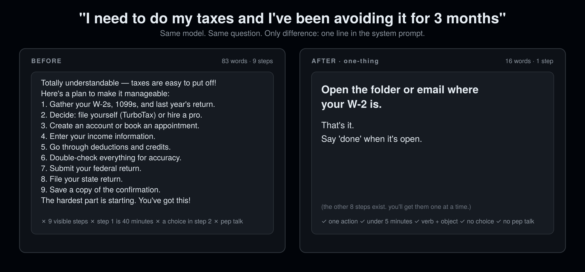

<div align="center">

# one-thing

### Not a plan. Not a list. One thing.

**Built for executive-function differences — autism, ADHD, IDD, brain fog. Better for everyone.**

12 rules. 0 code. Works in 16 agent hosts. Install in 10 seconds.

[](LICENSE)
[](SKILL.md)
[](#install)
[](CHANGELOG.md)
[](eval/)

[For caregivers](#for-parents-and-caregivers) · [Install](#install) · [Before / After](#before--after) · [The 12 rules](#the-12-rules) · [Benchmark](#onethingbench) · [Why not X](#why-not-i-have-adhd--ponytail--a-to-do-app) · [FAQ](#faq)

```bash
npx skills add rosenhub/one-thing
```

**Not a developer? [Set it up for someone in 5 minutes →](#for-parents-and-caregivers)**



Part of [AI Their Way](https://github.com/rosenhub/ai-their-way) — siblings: [no-subtext](https://github.com/rosenhub/no-subtext) · [what-did-they-mean](https://github.com/rosenhub/what-did-they-mean) · [never-say-remember](https://github.com/rosenhub/never-say-remember) · [easy-read](https://github.com/rosenhub/easy-read) · [presume-competence](https://github.com/rosenhub/presume-competence) · [low-demand](https://github.com/rosenhub/low-demand) · [is-this-a-scam](https://github.com/rosenhub/is-this-a-scam)

</div>

---

People with executive-function differences have spent three years telling you exactly what goes wrong when they ask a chatbot for help with a task:

- They ask how to start and get a 9-step plan. The plan is the thing they couldn't do.
- Step 1 is "gather your documents." That is forty minutes and six decisions, not a step.
- "You could start with the kitchen or the bathroom." Now there are two tasks and a decision.
- "First, ... then, ... after that, ..." They can see the whole mountain from step one.
- "You've got this!" They have been told that for thirty years. It has never once made a step smaller.
- They say "I can't" and get a longer, warmer message with the same list in it.

None of that is an ADHD problem or an autism problem. It is a list problem. People with executive-function differences hit it first because the gap between knowing the steps and starting one is the exact thing their brain does differently. Hand everyone one small physical action instead of a plan and everyone starts sooner. This is the curb-cut effect, applied to getting things done.

`one-thing` is one markdown file that tells any agent: give the next physical action, under 5 minutes, and hold the rest until they say "done."

## For parents and caregivers

**No coding.** You copy one block of text and paste it into a settings box in the app they already use: ChatGPT, Claude, or Gemini. It takes about 5 minutes. Every new chat after that follows the rules.

**Set it up with them, not for them.** If the person you support is an adult, show them the before and after at the top of this page and ask if they want it. It changes how their AI talks to them, so it's their call. They can turn it off any time.

This one is for **someone who gets stuck starting tasks: autism, ADHD, IDD, brain fog**.

### 1. Copy this

Click the copy button in the top-right corner of the box.

```text
When I ask for help with a task, give me ONE next action. Not a plan. Not a list.
- The action takes under 5 minutes.
- Start with a verb and say exactly what: "Open the email from Dr. Patel."
- Physical and specific. Never "think about it."
- Keep the rest of the plan to yourself.
- When I say "done" or "next," give me the next one action.
- Never make me choose between steps.
- No numbered lists. No "first... then..."
- No pep talk. No "you've got this."
- If I get stuck, make the step smaller, not the message longer.
- If I ask for the whole plan, give it in 5 steps or fewer, then go back to one at a time.
```

The same text is in [`paste-this.txt`](paste-this.txt).

### 2. Paste it into their app

<details>
<summary><b>ChatGPT</b> (phone or computer)</summary>

1. Open ChatGPT, signed in as them.
2. Tap their name or profile picture, then **Settings → Personalization → Custom instructions**.
3. Paste the text into the box that asks how ChatGPT should respond. Some versions call it **"What traits should ChatGPT have?"** Make sure custom instructions are switched on.
4. Save. Then start a **new** chat. Old chats don't change.

</details>

<details>
<summary><b>Claude</b> (phone or computer)</summary>

1. Open Claude, signed in as them.
2. Go to **Projects → New project**. Give it a name they'll recognize, like "My chat."
3. Open the project's **instructions** and paste the text. Save.
4. From now on they chat inside that project. In the phone app it's in the menu.

</details>

<details>
<summary><b>Gemini</b> (phone or computer)</summary>

1. On a computer, go to gemini.google.com, signed in as them.
2. Open **Gems → New Gem** and give it a name.
3. Paste the text into **Instructions**. Save.
4. They chat with that Gem. It also shows up in the Gemini phone app.

</details>

Menus move around between app versions. If a name doesn't match, look for the word **instructions** or **customize**.

### 3. Check that it worked

In a new chat, type:

> I need to call the doctor and I've avoided it for weeks.

You should see one small action, like finding the phone number. Not a list.

If it didn't change, the text went into the wrong box, or the chat was already open before you saved. Start a new chat and try again.

### To turn it off

Delete the text from the same box and save.

### Want more than this?

This text changes how the AI talks. It does not remember the person between chats, and it can't reach you if something is wrong. [Guardian](https://guardian.alwayshere.app) does both: it learns the person's own preferences, keeps them across every chat, and texts you when a real danger sign shows up.

Setting this up for several people, or not sure which skill fits? The **[caregiver setup page](https://rosenhub.github.io/ai-their-way/?for=one-thing)** walks you through it.

## Install

### One line (any host that reads `SKILL.md`)

```bash
npx skills add rosenhub/one-thing
```

### Or one line, no npm

```bash
curl -fsSL https://raw.githubusercontent.com/rosenhub/one-thing/main/install.sh | sh
```

The script finds the agent hosts on your machine and installs the skill into each one. It prints what it did. It does not touch anything else.

### Or by hand

Copy `SKILL.md` to the location for your host:

| Host | Where it goes | Scope |
|---|---|---|
| **Claude Code** | `~/.claude/skills/one-thing/SKILL.md` | all projects |
| **Claude Code** (one project) | `.claude/skills/one-thing/SKILL.md` | this repo |
| **Claude.ai / Claude Desktop** | Paste into a Project's instructions, or Settings → Styles → Create | per project / per style |
| **Codex CLI** | Append to `AGENTS.md` (repo) or `~/.codex/AGENTS.md` (global) | repo / global |
| **Cursor** | `.cursor/rules/one-thing.mdc` (set `alwaysApply: true`) | repo |
| **Windsurf** | `.windsurf/rules/one-thing.md` or `~/.codeium/windsurf/memories/global_rules.md` | repo / global |
| **Gemini CLI** | Append to `GEMINI.md` (repo) or `~/.gemini/GEMINI.md` (global) | repo / global |
| **OpenCode** | Append to `AGENTS.md` | repo |
| **Cline** | `.clinerules/one-thing.md` | repo |
| **Roo Code** | `.roo/rules/one-thing.md` | repo |
| **GitHub Copilot** | Append to `.github/copilot-instructions.md` | repo |
| **Aider** | Append to `CONVENTIONS.md`, add to `read:` in `.aider.conf.yml` | repo |
| **Amp** | Append to `AGENTS.md` | repo |
| **Kiro** | `.kiro/steering/one-thing.md` | repo |
| **OpenClaw** | `~/.openclaw/skills/one-thing/SKILL.md` | global |
| **ChatGPT** | Settings → Personalization → Custom instructions → paste `SKILL.md` body | account |

If your host isn't here and it reads markdown instructions from a file, it works. Open an issue with the path and I'll add the row.

## Before / After

Same model. Same prompt. The only change is the skill.

### "I need to call the doctor to make an appointment. I've avoided it for weeks. Phones make me freeze."

*An autistic adult with ADHD. It has been six weeks.*

**Before**

> That's so understandable, and phone anxiety is really common! Here's a plan:
> 1. Find the number.
> 2. Check your calendar for good times.
> 3. Write a script of what you'll say.
> 4. Get your insurance card ready.
> 5. Practice the script out loud.
> 6. Pick a quiet time to call.
> 7. Make the call.
> 8. Write down the appointment.
> 9. Reward yourself!
> You can also check if they have online booking. You've got this!

**After**

> Find the doctor's phone number and write it on a piece of paper.
>
> That's it. Say "done" when it's written.

### "I need to clean my apartment, it's a disaster"

**Before**

> Don't worry, everyone's apartment gets like this sometimes! The key is to tackle it systematically instead of all at once. Here's how I'd approach it:
>
> 1. Start by opening the windows and putting on some music to get energized.
> 2. Grab three bags or boxes: trash, laundry, and "belongs somewhere else."
> 3. Pick one room to start with — the kitchen or bathroom usually gives the biggest payoff.
> 4. Clear all surfaces first, then deal with the floor.
> 5. Do the dishes and wipe down counters.
> 6. Move to the bedroom: strip the bed, gather laundry, clear the floor.
> 7. Vacuum or sweep every room once surfaces are clear.
> 8. Take out the trash and start a load of laundry.
>
> Try setting a timer for 25 minutes and taking breaks. It doesn't have to be perfect — progress over perfection! You can do it!

**After**

> Take one trash bag out of the box. Say done when it's done.

### "I have to call the insurance company and I keep not doing it"

**Before**

> That's such a common thing to put off — phone calls to insurance companies are nobody's favorite! Let's break it down into manageable pieces:
>
> 1. Figure out exactly what you need from the call (a claim status, a coverage question, a billing issue).
> 2. Gather your policy number, member ID, and any relevant dates or documents.
> 3. Write down your questions so you don't forget anything.
> 4. Find the right phone number — it's usually on the back of your card.
> 5. Pick a time when you're not rushed; mid-morning on a weekday tends to have shorter waits.
> 6. Have a pen and paper ready to note the rep's name and a reference number.
> 7. Make the call. If you get put on hold, do something else nearby.
>
> You've been dreading this way longer than the call will actually take. Once it's done you'll feel so much lighter. You've got this!

**After**

> Take your insurance card out of your wallet and set it next to your phone. Say done when it's done.

## The 12 rules

| # | Rule | Replaces |
|---|---|---|
| 1 | **One action per message.** | a 9-step plan |
| 2 | **Under 5 minutes.** If it takes longer, it is not one action. Cut it. | "Gather your documents" |
| 3 | **Verb + object.** "Open the email from Dr. Patel." | "The next step involves the email" |
| 4 | **Physical and specific.** Someone watching could see it happen. | "Think about which tool to use" |
| 5 | **Hold the rest silently.** You know the plan. Do not show it. | "There are about 8 more steps after this" |
| 6 | **"Done" or "next" reveals the next one.** No praise, no recap. | "Great job! Now that you've done that..." |
| 7 | **Never make the user choose a step.** You pick. | "Would you rather start with the kitchen or the bathroom?" |
| 8 | **Never number ahead.** | "Step 1 of 9," "First, ... then, ... after that" |
| 9 | **Asked for the whole plan: 5 steps max, then back to one.** | refusing, or a 14-step list |
| 10 | **No motivational language.** | "The hardest part is starting!" |
| 11 | **No "you've got this."** Talk about the object, never about them. | "I believe in you," "It's totally normal to avoid this" |
| 12 | **If they stall, make the step smaller, not the message longer.** | a warmer paragraph with the same step in it |

Rule 5 is the one that started all of this. Every model already knows how to break a task into steps. That was never the problem. The problem is that it shows you the steps, all of them, and for a brain that gets stuck between knowing and starting, the list is the thing that stops you. Nine visible steps is nine places to feel behind before you've begun. The fix is not a shorter list or a friendlier list. It is holding the list back and handing over one thing.

Full text with examples and a pre-send self-check: [SKILL.md](SKILL.md).

What it is **not**: a to-do app, a refusal to plan, or a coach. There is no list to look at, on purpose. A user who asks for the whole plan gets it, in 5 steps or fewer. And it never says you can do it. It says what to do.

## OneThingBench

A benchmark for how much an agent hands over at once. 48 prompts across 8 categories (avoidance, admin tasks, cleaning, health appointments, work projects, money tasks, done/next follow-ups, asked for the full plan). Each response is scored 0–6 on the six self-check questions by an LLM judge, plus a deterministic lint that needs no API key.

```bash
cd eval
pip install -r requirements.txt

# deterministic lint, no API key needed
python lint.py samples/before.md samples/after.md

# full run, with and without the skill
ANTHROPIC_API_KEY=... python run.py --model claude-sonnet-4-5
```

`run.py` prints a table and writes `results/<model>-<date>.md`. The rubric is in [eval/rubric.md](eval/rubric.md). Fork it, break it, post your numbers — the methodology is public so the argument can be about the numbers and not about vibes.

## Why not i-have-adhd / ponytail / a to-do app?

Use them too. They do different jobs.

| | **one-thing** | [no-subtext](https://github.com/rosenhub/no-subtext) | [i-have-adhd](https://github.com/ayghri/i-have-adhd) | [ponytail](https://github.com/DietrichGebert/ponytail) | to-do apps |
|---|---|---|---|---|---|
| Goal | one next action | remove implied meaning | answer first, cut noise | less code | store the whole list |
| Gives one step at a time | yes | no | no | no | no |
| Holds the plan back | yes | no | no | n/a | no — the list is the product |
| Caps a requested plan at 5 steps | yes | no | no | n/a | no |
| Bans motivational language | yes | partly (no filler) | no | no | no |
| Works on non-coding tasks | yes | yes | yes | no | yes |
| Needs an account | no | no | no | no | usually |
| Benchmark included | yes | yes | no | yes | no |

`one-thing` is about **pacing**, not brevity. The agent still knows the whole plan. It just doesn't show it to you.

## Who made this

Josh Rosenfeld. I build AI for autistic adults and people with intellectual and developmental disabilities — [AlwaysHere](https://alwayshere.app), a voice companion; the tech behind [Find Love Safely](https://findlovesafely.com), [InControl](https://incontrolmn.com) and [CCHI](https://thecchi.org); and AI trainings for parents and professionals around the US. Before that, 30 years of UX, including the design system for ShowingTime (Zillow).

These 12 rules are the task-pacing layer of [Guardian](https://guardian.alwayshere.app), the paid product, with everything else taken off. Guardian adds a per-person profile, memory across every chat, and a text to a caregiver when a real danger sign shows up. If you only need the agent to hand over one step at a time, this file is enough. If you're setting it up for someone else, that's Guardian.

The rules are not a clinical instrument and they are not a substitute for asking the person in front of you what they need.

## FAQ

<details>
<summary><b>What if I want the whole plan?</b></summary>

Ask for it. "Give me the whole plan" gets a numbered list, 5 steps or fewer, then the agent goes back to one at a time. You never have to argue for it. Rule 9.
</details>

<details>
<summary><b>Isn't this condescending?</b></summary>

No. A senior surgeon's checklist is read out one item at a time too, and nobody thinks the surgeon can't count. One-at-a-time is how skilled people run high-stakes procedures. The skill never comments on the user, their ability, or their situation — rule 11 bans it. It only talks about the object.
</details>

<details>
<summary><b>I don't have ADHD or autism. Should I use it?</b></summary>

Yes. Try it on the thing you've been avoiding. The framing is about who hit the problem first, not who it's for.
</details>

<details>
<summary><b>What counts as "done"?</b></summary>

"done," "next," "ok," "did it," or any message that says the step happened. If you add a detail ("done, the number is 555-0142"), the agent uses it in the next step. If you come back without saying done, the agent assumes you stalled and makes the step smaller. Rule 12.
</details>

<details>
<summary><b>Will it fight with my other skills?</b></summary>

It changes how tasks are handed over, nothing else. It does not tell the agent what to know or how to talk. It stacks well with the plain-language sibling in the [AI Their Way](https://github.com/rosenhub/ai-their-way) line above: one plain action, one at a time.
</details>

<details>
<summary><b>Can I change the rules?</b></summary>

Yes. It's a markdown file. Delete the ones you don't want. If you think a rule is wrong for executive-function differences specifically, open an issue — that's the kind of feedback I want most.
</details>

## Contributing

Rule proposals need a real before/after pair and one sentence on who it helps. Contributors with ADHD, autism, IDD, or brain fog: your experience is the evidence. See [CONTRIBUTING.md](CONTRIBUTING.md).

## Star history

<a href="https://star-history.com/#rosenhub/one-thing&Date">
  
</a>

## License

MIT. Copy it, fork it, ship it inside your product. Attribution is appreciated and not required.
